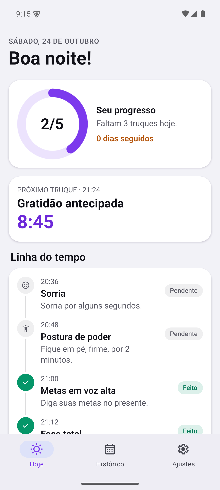
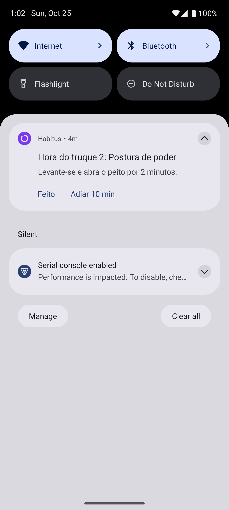
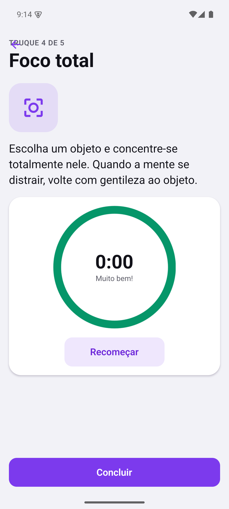
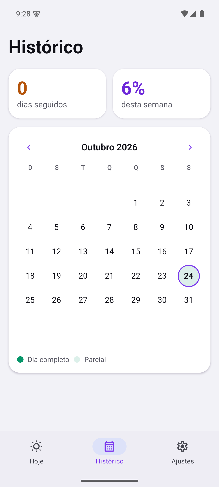

# Habitus

App para iOS e Android que ajuda você a praticar **6 dicas de bem-estar** ao longo do dia. Você escolhe o início e o fim do seu dia: o Habitus distribui 5 dicas de forma uniforme nessa janela, e a 6ª ("Antes de dormir") chega na hora em que você costuma dormir, horário que o app aprende sozinho. Cada um vem com uma notificação local. Não tem login nem servidor, e os dados ficam no aparelho.

| Hoje | Notificação | Dica | Histórico |
|---|---|---|---|
|  |  |  |  |

Capturas do emulador Android 15 em [`docs/screenshots/android/`](docs/screenshots/android/). As de [`docs/screenshots/`](docs/screenshots/) vêm do preview web (inclui modo escuro), onde a barra de abas aparece no topo.

## Requisitos

- Node.js 24 LTS e npm
- Para rodar no celular, o app **Expo Go** ([iOS](https://apps.apple.com/app/expo-go/id982107779) / [Android](https://play.google.com/store/apps/details?id=host.exp.exponent)), ou um simulador/emulador

## Como rodar

```bash
npm install
```

### No navegador

```bash
npm run dev
```

Abre o app em http://localhost:8081. É a versão web/PWA: tem tudo (onboarding, dicas, histórico, conquistas, ajustes), e os lembretes funcionam enquanto a aba está aberta. No celular, em desenvolvimento o app abre direto no navegador; para ver a tela de instalação, acrescente `?instalar` ao endereço (por exemplo `http://192.168.0.10:8081/?instalar`).

### No celular (app nativo)

```bash
npx expo start
```

No terminal do Expo, `a` abre no emulador Android e `i` abre no simulador iOS (só no macOS). Veja a observação sobre o Expo Go mais abaixo.

## Instalar como app pelo navegador (PWA)

O Habitus é um PWA: dá para instalar pelo navegador, sem loja, no Android e no iPhone.

- **No computador:** o app funciona direto no navegador.
- **No computador, sem login:** `/` mostra a landing page (benefícios, como funciona, recursos, planos e dúvidas) com os botões Começar grátis e Entrar.
- **No celular, pelo navegador:** o app mostra só uma tela de apresentação (como funciona em 3 passos, os benefícios das 6 dicas, sem revelar quais são, e o teste de 7 dias com cadastro) com o botão **Instalar agora** embaixo. Para usar, é preciso instalar e abrir pelo ícone da tela inicial. Isso vale também para links diretos.
  - **Android (Chrome, Edge, Samsung Internet):** o botão abre a janela de instalação do próprio navegador.
  - **iPhone/iPad (Safari):** a Apple não oferece nenhum jeito de um site abrir a janela "Adicionar à Tela de Início". Só o próprio usuário abre, pelo botão Compartilhar. O botão mostra os 3 passos com ícones e uma seta apontando para a barra do Safari.
  - **Instagram, WhatsApp, Facebook:** esses navegadores embutidos não instalam apps. O botão explica como abrir no navegador e oferece **Copiar link**.
- **App instalado (aberto pela tela inicial):** funciona normalmente.

Para instalar no celular, o app precisa estar publicado num endereço **HTTPS**, porque o celular não acessa o `localhost` do seu PC e os navegadores só instalam PWAs servidos com HTTPS. Para gerar os arquivos:

```bash
npx expo export -p web
```

A pasta `dist/` é um site estático. Publique-a em qualquer hospedagem com HTTPS: EAS Hosting (`npx eas-cli@latest deploy`), Netlify, Vercel, Cloudflare Pages ou GitHub Pages. Configure a hospedagem para responder `index.html` em qualquer rota (modo SPA).

**Vercel:** o `vercel.json` já define o build (`npx expo export -p web`), a pasta `dist` e o modo SPA. Importe o repositório na Vercel e faça o deploy, sem configuração extra.

**Lembretes no PWA:** com o Web Push configurado (passo 9 de [docs/supabase-setup.md](docs/supabase-setup.md)), o app manda a lista de lembretes para o Supabase e uma função envia cada um na hora, então eles chegam com o Habitus fechado. Sem o Web Push, os lembretes só chegam enquanto o app está aberto ou foi minimizado há pouco. O toque abre a dica. No iPhone, as notificações só existem depois de instalar na Tela de Início (iOS 16.4+). As ações "Feita"/"Adiar" existem só no app nativo.

## Hora de dormir (6ª dica)

A dica "Antes de dormir" pede para dizer: *"Deus, universo, vida: me surpreenda positivamente amanhã."* O horário da notificação é aprendido assim (`src/domain/bedtime.ts`):

1. No onboarding (e em Ajustes) você informa a hora em que costuma dormir. O padrão é 23:00.
2. Toda vez que você conclui a dica, o app guarda o horário. Esse é o momento real em que você está indo dormir.
3. O lembrete vai para a **mediana das últimas 7 noites**, arredondada a 5 min. A mediana ignora uma noite fora da curva.
4. Se você usou o app no dia mas não respondeu a dica da noite, provavelmente já dormia quando ela chegou. Por isso, o próximo aviso vem 10 min mais cedo por noite assim, até 30 min.
5. Concluir até as 6h conta para a noite anterior (00:30 é "a noite de ontem").
6. O lembrete nunca vem antes de 30 min depois do fim da janela do dia. Mudar a hora em Ajustes recomeça o aprendizado.

## Água (opcional)

Em Ajustes → Água dá para ligar lembretes de beber água, escolher a meta do dia em copos e de quanto em quanto tempo lembrar. Os lembretes vêm dentro do horário do seu dia, fora dos horários das dicas, e param quando a meta é batida. Na tela Hoje aparecem o contador e o botão "+1 copo". A contagem sincroniza entre aparelhos (vale a alteração mais recente de cada dia). Com a água ligada, o app agenda 3 dias à frente (o iPhone guarda no máximo ~64 notificações).

## Gamificação

A aba **Conquistas** junta mecânicas que já funcionam em outros apps:

- **XP e níveis (Duolingo):** +10 XP por dica, +25 por dia perfeito (todos os 6), +5 XP extra por dia de sequência (até +50) e +150 por semana perfeita (todos os dias ativos de domingo a sábado). Cada nível pede 50 XP a mais que o anterior (100, 150, 200…).
- **Patentes (faixas de artes marciais):** Branca → Amarela (nível 3) → Laranja (5) → Verde (8) → Azul (12) → Roxa (16) → Marrom (21) → Preta (27).
- **Medalhas com progresso (Apple Fitness):** 11 medalhas, como Primeiro passo, Dia perfeito, Em chamas (7 dias), Semana perfeita, Coração grato, Centena e Faixa Preta.
- **Celebração:** ao concluir uma dica aparece "+10 XP". Subir de nível, ganhar faixa ou medalha mostra um destaque com vibração.

Tudo é calculado a partir do histórico já salvo, então quem já usava o app começa com o XP que merece.

## Verificar o código

```bash
npm run check
```

Esse comando roda o ESLint rápido, o ESLint com tipos, o self-check das regras de qualidade, o `tsc --noEmit` e os testes Jest. A lógica de agendamento tem testes em `src/domain/__tests__/`, incluindo casos-limite: janela de exatamente 1 h, 59 min, fim antes do início, horários inválidos, 00:00–23:59, arredondamento, troca de horário de verão, dias inativos e o teto de notificações do iOS.

## Como testar as notificações

1. Abra o app no aparelho (Expo Go ou development build), conclua o onboarding e **permita as notificações**.
2. Vá em **Ajustes → Sons e notificações**:
   - **Testar uma notificação agora**: dispara um lembrete da dica 2 em 3 segundos.
3. Toque numa notificação de dica: o app abre direto na tela daquela dica.
4. Use as ações **Feito** e **Adiar 10 min**. No Android elas rodam sem abrir o app, inclusive com o app encerrado. No iOS elas abrem o app para registrar a ação.

### Android: permita "Alarmes e lembretes"

Sem essa permissão, o Android trata os lembretes como alarmes aproximados e pode entregá-los até 1 hora depois do horário. No emulador, sem a permissão, um lembrete das 20:36 chegou às 20:38:55. Com ela, os lembretes chegaram com menos de 1,2 s de atraso. O Android 14+ começa com essa permissão negada, então o app mostra o aviso **Lembretes podem atrasar** com o botão **Permitir horário exato**, que abre a tela do sistema.

Para conferir os horários reais, defina em Ajustes uma janela que comece daqui a 1–2 minutos (ex.: agora 10:03 → 10:05–11:05). As dicas chegam às 10:11, 10:23, 10:35, 10:47 e 10:59.

> **Expo Go no Android não serve para este app.** O Expo Go Android mais recente para o SDK 58 (58.0.5) não traz o módulo nativo `ExpoTopicSubscriptionModule`, que o `expo-notifications` 58.x carrega ao iniciar. O app quebra com "Cannot find native module 'ExpoTopicSubscriptionModule'". No Android, use um development build (seção abaixo). No iOS, esse módulo é só um stub em JS, então o Expo Go deve funcionar, mas isso não foi verificado por falta de Mac.

### Development build no Android (sem conta EAS)

Requer o Android SDK (`ANDROID_HOME`) e o JDK 17.

```bash
npx expo prebuild -p android
```

```bash
cd android && ./gradlew assembleDebug -PreactNativeArchitectures=x86_64
```

```bash
adb install -r android/app/build/outputs/apk/debug/app-debug.apk
```

Depois, com o Metro rodando (`npx expo start`), abra o app "Habitus" no emulador. Num celular físico, troque `x86_64` por `arm64-v8a`, ou simplesmente rode `npx expo run:android` com o aparelho conectado.

## Gerar o build com EAS

```bash
npm install -g eas-cli
```

```bash
eas login
```

```bash
eas build:configure
```

Esse comando cria o `eas.json` com os perfis `development`, `preview` e `production`. Depois:

```bash
eas build --profile development --platform android
```

```bash
eas build --profile production --platform all
```

```bash
eas submit --platform ios
```

O build de iOS exige uma conta Apple Developer. O identificador do app é `com.habitus.app` (em `app.json`); troque pelo seu antes do primeiro build de produção.

## Estrutura

```
src/app         telas (Expo Router): onboarding, (tabs)/index|history|settings, trick/[id]
src/components  componentes visuais
src/domain      regras puras e testadas (agendamento, histórico, dados)
src/services    AsyncStorage, expo-notifications, tarefa em background
src/state       estado global e roteamento de notificações
src/theme       cores, tipografia e espaçamentos
```

Mais detalhes em [PRODUCT.md](PRODUCT.md), [docs/architecture.md](docs/architecture.md), [docs/design.md](docs/design.md) e [docs/quality.md](docs/quality.md).
